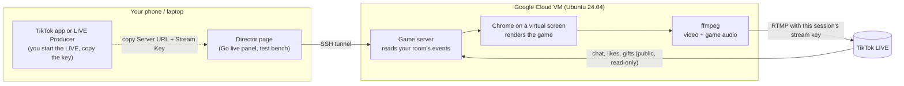

# Arcade Arena: cloud and TikTok setup, step by step

## The map



The VM does the heavy lifting and the uploading. Your home connection only
carries the director page, so a Wi-Fi drop does not drop the stream.

## What each account is for, and what never gets shared

| Thing | Used for | Who types it, where | Shared with Claude? |
|---|---|---|---|
| Google account (your Gmail) | signing in to Google Cloud console | you, in your browser | never |
| TikTok login (via Google) | starting the LIVE, opening LIVE Producer | you, on TikTok | never |
| TikTok username | the game reads your room's public events | `/etc/arena/arena.env` on the VM | yes, it is public |
| Stream Key + Server URL | sending video to your LIVE | director Go live panel (stays in VM memory) | never |
| Director key | locks the director page | `/etc/arena/arena.env` on the VM | no need |
| GitHub token (read-only, one repo) | cloning the private repo onto the VM once | you, on the VM | never |

Nothing in this setup needs your Google or TikTok password. The game reads
your room the same way any viewer's app does, by username. Because one
Google login guards both Google Cloud and TikTok, turn on 2-Step
Verification for it (Google Account > Security) before you start.

**Main or secondary TikTok account?** Use your main account for the real
show: stream key access reportedly needs about 1,000 followers and age 18+,
and is rolled out by account and region (third-party guides, not TikTok
docs). Keep the secondary account as a test viewer: from it you can like,
chat and send a cheap gift to your own LIVE to check the game reacts.

## Phase 1: accounts (about 15 minutes, once)

1. Google Account > Security: turn on 2-Step Verification.
2. Sign up for Google Cloud with the same Google account at
   https://cloud.google.com/free . New customers get $300 of credit for 90
   days; a card is required for identity, and you are not charged during the
   trial unless you upgrade to a paid account.
3. In the console: Billing > Budgets & alerts > create a budget (for example
   $50/month) with email alerts at 50%, 90% and 100%.
4. GitHub: nothing to do while the repository is public. If you make it
   private, create a fine-grained token with read-only "Contents" access to
   `nickeleyesolutions/TiktokApps` for cloning.
5. TikTok, on desktop: open LIVE Producer (https://livecenter.tiktok.com/producer)
   while logged in. If it offers a Server URL and Stream Key after you set a
   title and category, you have key access. If it does not, stop here and tell
   me; the fallback is OBS on your computer.

## Phase 2: create the VM (about 5 minutes, once)

In the console click "Activate Cloud Shell" (top right). It opens a terminal
already signed in as you. Paste:

```bash
gcloud config set project YOUR_PROJECT_ID
```
(the project ID is shown in the console's project picker; the free trial creates "My First Project")
```bash
gcloud services enable compute.googleapis.com
```
```bash
gcloud compute instances create arena --zone=us-central1-a --machine-type=e2-standard-8 --image-family=ubuntu-2404-lts-amd64 --image-project=ubuntu-os-cloud --boot-disk-size=30GB
```

- `e2-standard-8` (8 vCPU) for 1080p; `e2-standard-4` is enough for 720p.
- Pick a zone near you. Streaming sends out about 2.7 GB per hour at 6000
  kbps (1080p) or 1.4 GB per hour at 3200 kbps (720p); check current VM and
  network prices in the console's pricing calculator.
- No firewall rules to add: the director goes through an SSH tunnel.
- To save money between shows: `gcloud compute instances stop arena --zone=us-central1-a`
  (and `start` before the next one). A stopped VM still pays for its disk.

## Phase 3: install the game on the VM (about 10 minutes, once)

```bash
gcloud compute ssh arena --zone=us-central1-a
```
On the VM (the Debian image has no git, so install it first; harmless on Ubuntu):
```bash
sudo apt-get update && sudo apt-get install -y git
```
```bash
git clone -b claude/confident-pascal-8nd2c3 https://github.com/nickeleyesolutions/TiktokApps.git
```
The repository is public, so no login is asked. (If it is ever made private,
use your GitHub username and a read-only token as the password.)
```bash
sudo bash TiktokApps/arcade/deploy/gcp-setup.sh
```
```bash
sudo nano /etc/arena/arena.env
```
Set `TIKTOK_USERNAME` (no @) and `DIRECTOR_KEY` (any long random string;
`BROADCAST=1` is already set). Save, then:
```bash
sudo systemctl restart arena-server
```
```bash
curl -s localhost:3000/api/health
```
`ok: true` and `bridge.status: waiting-for-live` means it is ready and waiting
for you to go live.

## Phase 4: rehearsal (once, about 20 minutes)

1. On your laptop, open a tunnel and leave the window open:
   ```bash
   gcloud compute ssh arena --zone=us-central1-a -- -L 3000:localhost:3000
   ```
2. Browse to `http://localhost:3000/?obs` (the stage) and
   `http://localhost:3000/director?key=YOUR_DIRECTOR_KEY` (the director).
3. Director > Crowd simulator > Med: watch the game play itself. Try the test
   bench buttons (Whale finisher, Orbital, Rift, Randonaut).
4. Do a short real LIVE (Phase 5) with your secondary account in the room as
   a viewer; like, chat "a", send a Rose. Check the director's event feed.

## Phase 5: every show

1. TikTok LIVE Producer: set title and category, Save & Go LIVE, copy the
   Server URL and Stream Key. (Keys are reported to change every session.)
2. Laptop or phone: tunnel open, director open, Go live panel: paste both,
   pick 1080 or 720, **Start streaming**. Status should turn `live` with about
   30 fps.
3. Check your LIVE on your phone (on mobile data, not your Wi-Fi). The game
   server connects to your room on its own within a minute (Live source line).
4. During the show: be on mic now and then, use director buttons and `!`
   chat commands from your own account (add your username to
   `owners.usernames` in `/opt/arena/arcade/config/weights.json`).
5. End: director **Stop**, then end the LIVE in TikTok. Optionally stop the VM.

## A public HTTPS link to the game (for LIVE Studio, OBS, Streamlabs or a phone)

1. Console > Compute Engine > VM instances > your VM > **Edit** > Networking:
   tick **Allow HTTP traffic** and **Allow HTTPS traffic** > **Save**.
2. Console > VPC network > IP addresses: on your VM's external address click
   **Promote to static IP address** (keeps the link the same after stop/start).
3. On the VM:
   ```bash
   sudo bash TiktokApps/arcade/deploy/https-setup.sh
   ```
   It prints your links, for example
   `https://34-123-45-67.sslip.io/?obs` (game screen),
   `https://34-123-45-67.sslip.io/?obs&lite` (for LIVE Studio's built-in browser),
   `https://34-123-45-67.sslip.io/director?key=YOURKEY` (director, from any phone).

The game screen is read-only; every control needs the director key.

- TikTok LIVE Studio: Add source > **Link** > paste the `?obs&lite` link, size 1080 x 1920.
- OBS / Streamlabs: Add Browser Source > the `?obs` link, width 1080, height 1920,
  tick "Control audio via OBS".

## Soundtrack

Director > **Soundtrack & backdrops** > choose an MP3 (or M4A, OGG, WAV) > **Upload**,
then Look > **Soundtrack** > pick it. It loops, dips under cinematics, and
replaces the built-in chiptune (Stream > "Chiptune on top of soundtrack" to
layer both). Volume: Stream > Soundtrack volume. Uploaded files live in
`/opt/arena/arcade/public/assets` and survive updates. Use music you have the
rights to stream.

## Auto messages for chat

The director's **Auto messages for chat** card always shows a message for the
current moment (rules, room goals, crowd votes, final blows). Tap **Copy
message** and paste it into your LIVE chat; **Next message** shows another.
This needs nothing else and posts nothing on its own.

The on-screen **ARENA BOT** bubble (above the HOW TO PLAY panel) and the top
ticker do the same thing inside the game picture, so every viewer sees them
even if nobody types. Director > Live weights > Audience turns them on or off.

### Optional: a bot account that posts into the chat by itself

Read this first:
- Sending chat goes through Euler Stream's servers, and the connector's source
  says it "requires an API key & a paid plan" (message in
  `node_modules/tiktok-live-connector`, `sendRoomChatFromEulerRoute`). Check
  current plans and terms at https://www.eulerstream.com before paying.
- The bot account's login cookie is sent to that service. Use a **secondary**
  TikTok account, never your main one.
- tiktok-live-connector is unofficial ("not a production-ready API", its README).
  Whether TikTok restricts accounts that post automated messages: [citation needed].
  Keep the gap long (the code never posts more than once per 45 s).

Steps:
1. On a computer, log in to tiktok.com in a browser with the **secondary** account.
2. Open the browser's developer tools > Application (Chrome) or Storage
   (Firefox) > Cookies > `https://www.tiktok.com`. Find `sessionid` and
   `tt-target-idc` (the connector README, "Authenticated Connection", names
   these two cookies).
3. On the VM: `sudo nano /etc/arena/arena.env` and add three lines:
   `SIGN_API_KEY=...`, `CHATBOT_SESSIONID=...`, `CHATBOT_TT_TARGET_IDC=...`
   Type them on the VM yourself; do not paste them into a chat with anyone.
4. `sudo systemctl restart arena-server`
5. Director > Live weights > Audience > tick **TikTok chat bot**. The card
   under the message shows `chat bot: connected` and a posted count. If it says
   `needs a paid sign plan`, the Euler key does not allow sending.
6. Logging the secondary account out of TikTok in the browser ends that session
   and stops the bot; delete the lines from `arena.env` too.

## Rehearse the broadcast without TikTok

Streams to a stand-in receiver on the VM for 25 seconds and reports the game
fps, encoder fps and audio:

```bash
bash TiktokApps/arcade/deploy/selftest.sh
```
(`RES=720 bash ...` for 720p.) Look for `RESULT: broadcast pipeline works`,
a game fps of 28 or more, and an audio level well above -91 dB.

## Getting updates

When I push changes, run this on the VM. Your settings, tuned weights, hall of
fame and recordings are kept:

```bash
bash TiktokApps/arcade/deploy/update.sh
```

## Troubleshooting

- `curl -s localhost:3000/api/health` on the VM: `bridge.status`, `broadcast.status`, `stage.fps`.
- Logs: `journalctl -u arena-server -f`
- Go live panel says `reconnecting` with "Connection refused" or "I/O error":
  the key is stale or the LIVE is not started. Get a fresh key from LIVE
  Producer and paste again.
- `stage.fps` under 28: switch to 720 in the panel, or use a bigger VM.
- Game shows no viewers: check `bridge.status` is `connected`; the username in
  `arena.env` must be the one that is live.

## Render modes

`RENDER_MODE=cpu` (default) turns WebGL off in the headless Chrome and uses a
CPU bloom and scanline fallback: software WebGL stalls on every frame on
GPU-less VMs (measured 20 fps vs 50 to 60 fps without it). Lost in this mode:
CRT curvature, chromatic aberration, the dimension shader field and the prism
sheen. Hypercubes, orbit rings, cages, bloom and everything else stay.
`RENDER_MODE=gpu` is for a VM with an NVIDIA GPU and drivers; untested.

## Sources for the TikTok and Google facts above

- Stream key eligibility (about 1,000 followers, 18+, gradual rollout): third-party guides, e.g. https://bigvu.tv/blog/how-to-get-a-tiktok-stream-key/ , https://sendshort.ai/guides/tiktok-stream-key/ , https://hexeum.net/guides/how-to-get-a-tiktok-stream-key/ . Not confirmed in TikTok's own docs.
- New key per session, LIVE Producer location: https://livepush.io/blog/tiktok-stream-key/ , https://onestream.live/blog/tiktok-stream-key-guide/ (third-party).
- Google Cloud free trial terms: https://cloud.google.com/free-trial/ and https://cloud.google.com/signup-faqs
